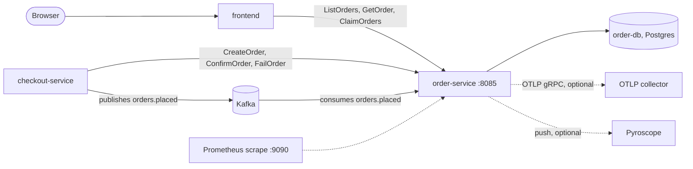
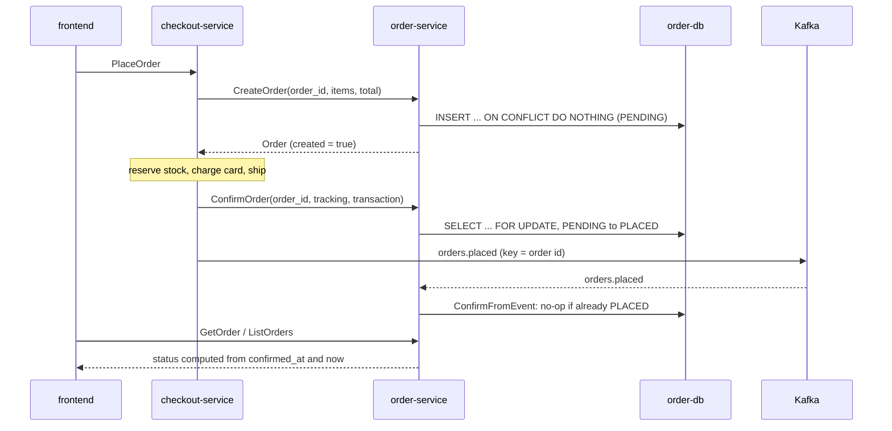

# Architecture

## Context

order-service never calls another service. The callers are checkout-service (`CreateOrder`, `ConfirmOrder`, `FailOrder` and, for idempotency, `GetOrder`) and the frontend (`ListOrders`, `GetOrder`, `ClaimOrders`); checked against the `origin/main` code of the callers on 2026-11-21. The diagram below shows the main ones.

## Main flow: placing an order

If any step fails, checkout calls `FailOrder`. If the `ConfirmOrder` call is lost but the event was published, the consumer moves the order from `PENDING` to `PLACED`. The order of the steps inside checkout is described in checkout-service's own documentation.

## Computed status

The stored state is `PENDING`, `PLACED` or `FAILED`. `PROCESSING`, `SHIPPED` and `DELIVERED` are derived on every read from `confirmed_at` and the configured offsets (`ORDER_PROCESSING_AFTER`, `ORDER_SHIPPED_AFTER`, `ORDER_DELIVERED_AFTER`) by the pure function `Stages.Schedule(order, now)`. `evaluated_at` in the response is the clock used.

## Start-up and readiness

1. Telemetry and profiling are configured (both off unless their variables are set).
2. The gRPC server listens at once, health is `NOT_SERVING`.
3. A background loop runs the goose migrations (retry every 2 s) and then pings the database every 5 s; health follows the ping.
4. The Kafka consumer (if configured) does not poll before the service is ready.

## Kafka consumer

With `KAFKA_BROKERS` set, the service consumes the topic `orders.placed` (key = order id, JSON value, schema version 1; the contract is owned by checkout, which publishes it) and confirms the order from each event. This is the self-healing path: if checkout published the event but its own `ConfirmOrder` call was lost, the order is still moved from `PENDING` to `PLACED` by the event. The handler goes through the same code as the `ConfirmOrder` RPC (`ValidateConfirm`, then the store transition under a row lock) via `Service.ConfirmFromEvent`; the topic is `orders.placed` with the optional prefix `KAFKA_TOPIC_PREFIX` in front (`dev.orders.placed`), and the settings are the three variables in the table above. On its first poll the consumer creates the topic if it does not exist (partitions and replication factor: the broker's defaults; an existing topic is left as it is; no permission to create is a warning, not a failure).

| Case | What happens |
|---|---|
| Order `PENDING` | `PENDING -> PLACED` with the event's `shipping_tracking_id` / `payment_transaction_id`; info log |
| Order already `PLACED` with the same ids (replay, or the RPC got there first) | no-op, counted as processed |
| Order `PLACED` with different tracking/transaction ids | not applied; error log; skipped |
| Order `FAILED` | never resurrected; error log `order.placed for a FAILED order order=<id>`; skipped |
| Unknown order id (event from another environment) | warn log; skipped |
| Tracking/transaction id empty or too long (breaks the RPC contract) | warn log; skipped |
| Malformed JSON, wrong field types, empty `order_id`, other `event_type` | warn log with topic/partition/offset; skipped |
| `schema_version` missing, invalid or not 1 | warn log with topic/partition/offset; skipped (checked before the other fields, so a future schema with changed types lands here) |
| Unknown JSON fields | ignored |
| Database down, service not ready, handler timeout (any error that is not one of the cases above) | retried with backoff 0.5 s doubling to 30 s, the same record, **never skipped**; later records wait behind it; the process does not exit |

Delivery is at-least-once, handling is idempotent. Offsets are committed by hand (auto commit is off) after a polled batch has been handled, skipped records included; if a commit fails the records are simply handled again after a restart or rebalance and recognised as replays. A new group starts at the earliest offset. A topic that was just created (or has no leader yet) is waited for: franz-go retries internally and re-reads the topic metadata at least every 15 s, and an `UNKNOWN_TOPIC_OR_PARTITION` that still reaches the consumer is logged at info (`waiting for topic`) and polled again every 2 s, never treated as a failure. The consumer does not poll before the database is migrated and reachable (the same readiness as the gRPC health), and the health check never looks at Kafka: Kafka down or slow changes nothing about SERVING/NOT_SERVING.

Shutdown: on SIGTERM the consumer finishes (and commits) the record it is handling, handles no further record of the batch, leaves the group and closes; one handling attempt is capped at 3 s and the commit at 3 s, and the process waits at most 8 s for it (inside the existing shutdown path, before the pool is closed).

Client: [franz-go](https://github.com/twmb/franz-go) v1.22.2 (pure Go, no cgo). PLAINTEXT without authentication only (the local demo broker); TLS/SASL options are not wired.

Logs of the consumer carry `order_id`, `topic`, `partition`, `offset` and never the payload (the event holds the customer's email and address). Metrics: see the observability page.

## Storage

See the Data section of the README in the repository root: tables `orders` and `order_items`, one migration (`00001_create_orders.sql`), embedded and applied at start-up.
